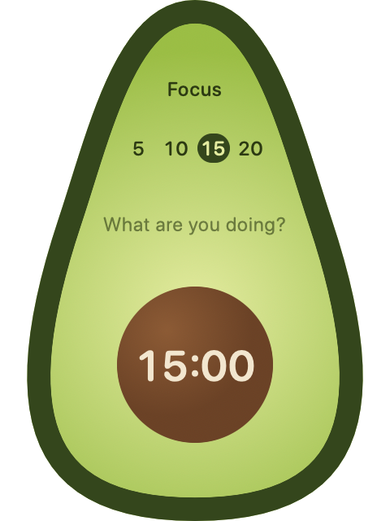
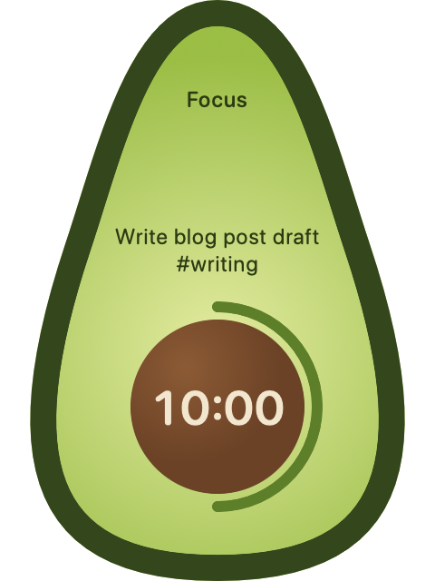
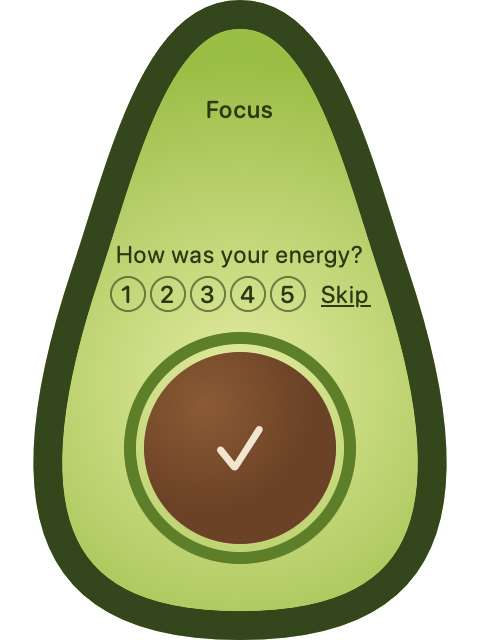

# Avodoro

A small macOS pomodoro timer shaped like a halved avocado. It floats above your other windows and lets you type what you're working on. When a session ends, it appends one line to a daily Markdown log, which can live inside an Obsidian vault.

<p align="center">
  
  
  
</p>

The log is the real product: it is plain text, stable and machine-parseable, so you (or a script) can later look for patterns in your focus, energy and breaks.

> **Status:** a personal tool, version 0.1. It works on my Mac. Some parts are not yet tested by hand (see "Current status" in [CLAUDE.md](CLAUDE.md)). There are no prebuilt releases; you build it from source.

## Features

- A floating, always-on-top avocado that stays visible over full-screen apps and on every Space. Drag it by its dark skin.
- You type the task in the avocado while the app you're using stays frontmost.
- Focus and break sessions with editable presets (default 5, 10, 15 and 20 minutes).
- Click the pit to start, pause and resume. Right-click for a menu. `⌘.` stops a session.
- After a focus session, an optional 1 to 5 energy rating.
- An end-of-session sound, notification and small bounce (a fade with Reduce Motion).
- Pauses when the Mac sleeps or the screen locks. It never resumes on its own.
- Crash recovery: an unfinished session is offered for logging at the next launch.
- Menu bar item with the remaining time.
- No network access, analytics or telemetry. The app writes only to your log folder and `~/Library/Application Support/Avodoro`.

## The log

One file per day, `<log folder>/YYYY-MM-DD.md`, starting with frontmatter:

```
---
type: pomodoro-log
date: 2026-10-15
tz: Europe/Rome
schema: 1
---

- 09:02-09:27 Write blog post draft #writing [type:: focus] [planned:: 25] [actual:: 25] [status:: completed] [energy:: 4]
- 09:27-09:32 Break [type:: break] [planned:: 5] [actual:: 5] [status:: completed]
- 10:40-10:52 Refactor parser #code [type:: focus] [planned:: 20] [actual:: 9] [status:: stopped] [paused:: 3] [energy:: 2]
```

- The fields use [Dataview](https://github.com/blacksmithgu/obsidian-dataview) inline syntax, so you can query them in Obsidian. Dataview is optional.
- Tags in the task text stay normal Obsidian tags.
- Lines are only ever appended; anything you write by hand in these files is left alone.
- If the folder isn't reachable, lines wait in a queue, a red dot appears on the avocado, and they're written later. A line is never dropped silently.

The full format, including the reference regex for parsers, is in the "The log format (schema 1)" section of [CLAUDE.md](CLAUDE.md).

## Requirements

- macOS 14 or newer
- Xcode 16 or newer (the full app, not only the Command Line Tools)
- [XcodeGen](https://github.com/yonaskolb/XcodeGen): `brew install xcodegen`

## Build and run

```sh
git clone https://github.com/mkaihara/avodoro.git
cd avodoro
make run
```

On first launch, the avocado says "Choose a log folder". Click it and pick a folder, for example one inside your Obsidian vault.

Other targets:

| Command         | What it does                                           |
| --------------- | ------------------------------------------------------ |
| `make gen`      | Generates the Xcode project from `project.yml`         |
| `make build`    | Builds into `build/`                                   |
| `make test`     | Runs the unit and snapshot tests                       |
| `make snapshot` | Renders the avocado in every state to `snapshots/*.png` |
| `make clean`    | Removes the build output and the generated project     |

Notes:

- The app is signed ad hoc and runs from `build/Build/Products/Debug/Avodoro.app`. Launch at login registers that path, so it stops working after `make clean` until you build again.
- The bundle id is the placeholder `com.example.avodoro`. Change it in `project.yml` if you like; settings are stored under that id.
- Diagnostics go to the unified log:
  ```sh
  log show --info --predicate 'subsystem == "com.example.avodoro"' --last 10m
  ```

## Project layout

```
Sources/Avodoro/
  App/       entry point, menu bar, app delegate, sound and notification
  Window/    the floating NSPanel, placement and dragging
  Timer/     TimerEngine (the state machine) and the Clock protocol
  Log/       log format, writer and pending queue
  Views/     the avocado and the Settings window
  Support/   settings, vault detection, sleep/lock events, crash recovery
Tests/AvodoroTests/
```

Behavior lives in `TimerEngine`, `LogFormat` and `LogWriter` and is tested without any UI. The engine takes a `Clock`, so tests never wait in real time.

[CLAUDE.md](CLAUDE.md) is the full spec and design record. The app was built with [Claude Code](https://claude.com/claude-code) from that file, milestone by milestone.

## License

Copyright 2026 Marcelo Kaihara.

Licensed under the [Apache License, Version 2.0](LICENSE).
